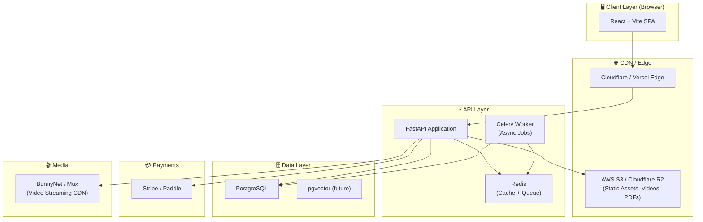
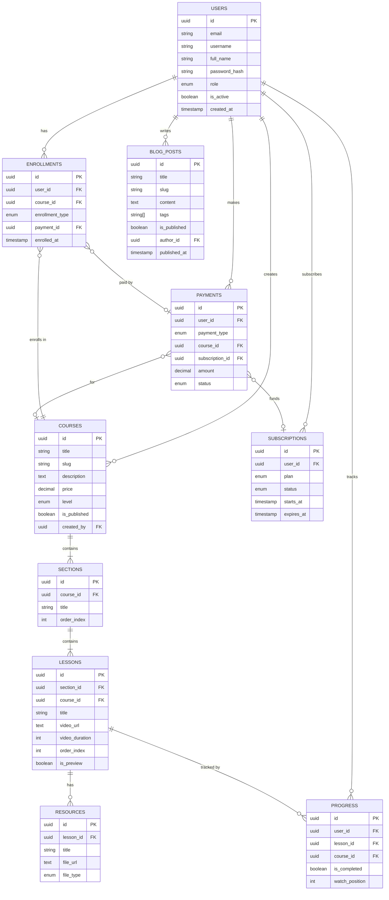
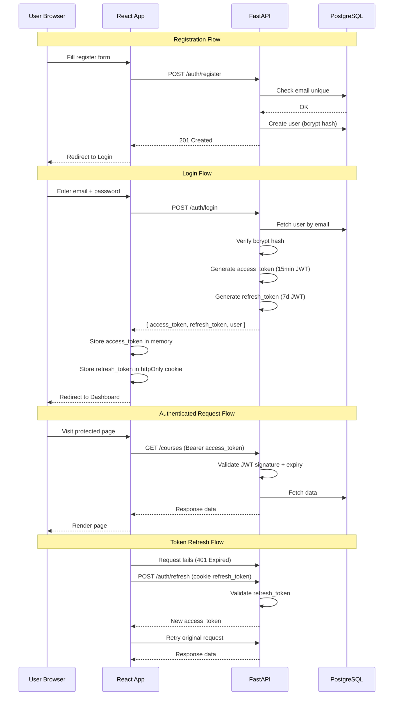
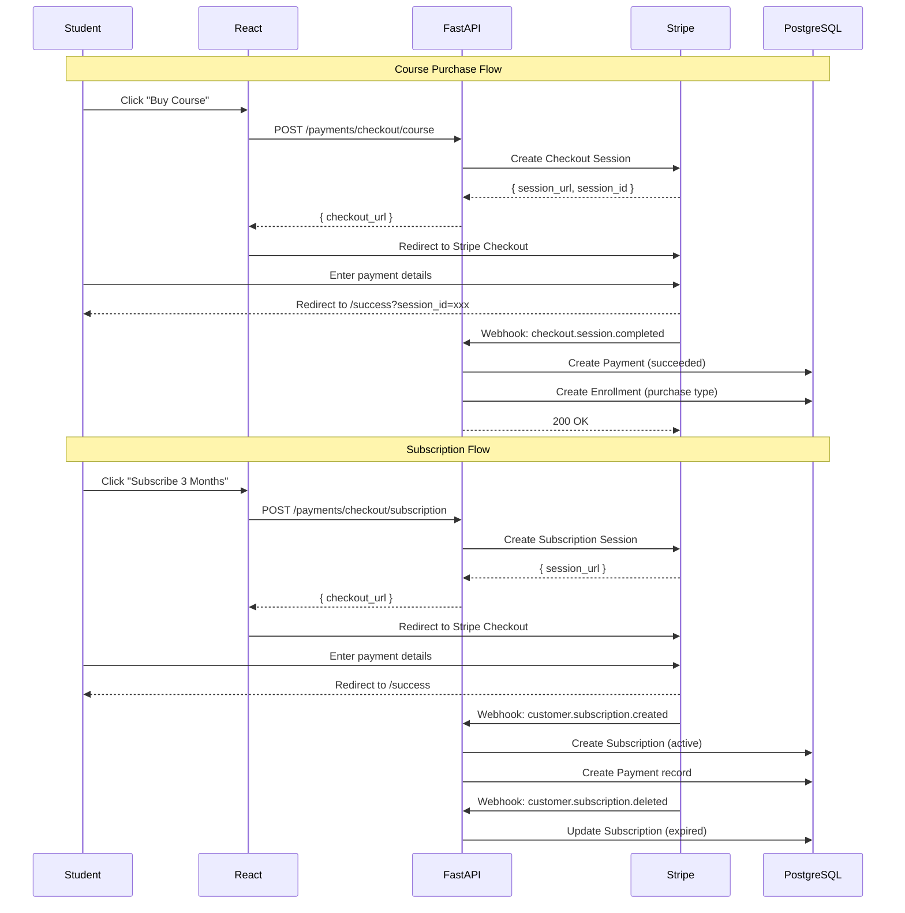
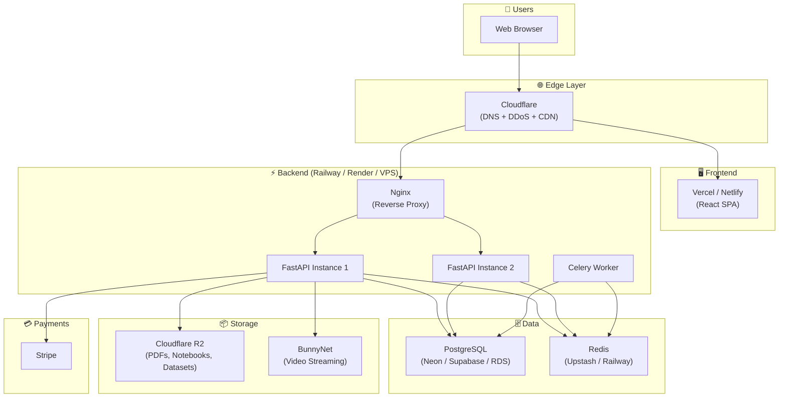

# Learnix — E-Learning Platform MVP
### Complete Software Architecture Blueprint

> **Stack**: Next + TypeScript + Vite + Tailwind CSS (Frontend) · FastAPI + PostgreSQL + SQLAlchemy (Backend)
> **Author**: Senior Software Architect · Production-Ready MVP Design
> **Date**: July 2026

---

## Table of Contents

1. [System Overview](#1-system-overview)
2. [High-Level Architecture](#2-high-level-architecture)
3. [Folder Structure — Frontend](#3-folder-structure--frontend)
4. [Folder Structure — Backend](#4-folder-structure--backend)
5. [Database Schema](#5-database-schema)
6. [ER Diagram](#6-er-diagram)
7. [API Design](#7-api-design)
8. [Authentication Flow](#8-authentication-flow)
9. [Payment & Subscription Flow](#9-payment--subscription-flow)
10. [Route Structure](#10-route-structure)
11. [UI Component Hierarchy](#11-ui-component-hierarchy)
12. [State Management](#12-state-management)
13. [Frontend Architecture](#13-frontend-architecture)
14. [Backend Architecture](#14-backend-architecture)
15. [File Naming Conventions](#15-file-naming-conventions)
16. [Coding Standards](#16-coding-standards)
17. [Security Best Practices](#17-security-best-practices)
18. [Deployment Architecture](#18-deployment-architecture)
19. [Scalability Recommendations](#19-scalability-recommendations)

---

## 1. System Overview

```
┌─────────────────────────────────────────────────────────────┐
│                    Learnix MVP                               │
│                                                              │
│   PUBLIC        STUDENT DASHBOARD       ADMIN PANEL         │
│   ─────────     ─────────────────       ──────────          │
│   Home          Dashboard               Courses CRUD         │
│   Pricing       My Courses              Lessons & Videos     │
│   about         Continue Learning       system settings        │
│   Login         Subscription            User Management      │
│   Register      Profile                 Purchases            │
│                                         Subscriptions        │
└─────────────────────────────────────────────────────────────┘
```

**Three User Roles:**

| Role    | Access Level                                      |
|---------|---------------------------------------------------|
| Guest   | Public pages only                                 |
| Student | Public + Student Dashboard + Purchased/Subscribed |
| Admin   | Everything + Admin Panel                          |

---

## 2. High-Level Architecture



---

## 3. Folder Structure — Frontend

```
frontend/
│
├── public/
│   ├── favicon.ico
│   ├── robots.txt
│   └── og-image.png
│
├── src/
│   │
│   ├── assets/                        # Static assets
│   │   ├── fonts/
│   │   ├── icons/
│   │   └── images/
│   │
│   ├── components/                    # Reusable UI components
│   │   ├── ui/                        # Base design system
│   │   │   ├── Button/
│   │   │   │   ├── Button.tsx
│   │   │   │   └── Button.types.ts
│   │   │   ├── Badge/
│   │   │   ├── Card/
│   │   │   ├── Input/
│   │   │   ├── Modal/
│   │   │   ├── Dropdown/
│   │   │   ├── Avatar/
│   │   │   ├── Spinner/
│   │   │   ├── Toast/
│   │   │   ├── Tabs/
│   │   │   ├── Progress/
│   │   │   └── index.ts               # Barrel export
│   │   │
│   │   ├── layout/                    # Layout components
│   │   │   ├── Navbar/
│   │   │   │   ├── Navbar.tsx
│   │   │   │   ├── NavLink.tsx
│   │   │   │   └── MobileMenu.tsx
│   │   │   ├── Footer/
│   │   │   ├── Sidebar/
│   │   │   │   ├── Sidebar.tsx
│   │   │   │   └── SidebarLink.tsx
│   │   │   ├── DashboardLayout/
│   │   │   ├── AdminLayout/
│   │   │   └── AuthLayout/
│   │   │
│   │   ├── course/                    # Course-specific components
│   │   │   ├── CourseCard/
│   │   │   ├── CourseGrid/
│   │   │   ├── CourseHero/
│   │   │   ├── CourseSyllabus/
│   │   │   ├── LessonList/
│   │   │   ├── VideoPlayer/
│   │   │   ├── ResourceDownload/
│   │   │   └── CourseProgress/
│   │   │
│   │   ├── blog/                      # Blog components
│   │   │   ├── BlogCard/
│   │   │   ├── BlogGrid/
│   │   │   ├── BlogHero/
│   │   │   └── TagBadge/
│   │   │
│   │   ├── pricing/                   # Pricing components
│   │   │   ├── PricingCard/
│   │   │   ├── PricingToggle/
│   │   │   └── FeatureList/
│   │   │
│   │   ├── auth/                      # Auth components
│   │   │   ├── LoginForm/
│   │   │   ├── RegisterForm/
│   │   │   └── ProtectedRoute/
│   │   │
│   │   └── dashboard/                 # Dashboard components
│   │       ├── StatsCard/
│   │       ├── RecentActivity/
│   │       ├── ContinueLearning/
│   │       └── SubscriptionBanner/
│   │
│   ├── pages/                         # Page-level components (routes)
│   │   ├── public/
│   │   │   ├── HomePage/
│   │   │   │   └── HomePage.tsx
│   │   │   ├── PricingPage/
│   │   │   │   └── PricingPage.tsx
│   │   │   ├── BlogPage/
│   │   │   │   └── BlogPage.tsx
│   │   │   ├── BlogDetailPage/
│   │   │   │   └── BlogDetailPage.tsx
│   │   │   ├── CourseCatalogPage/
│   │   │   │   └── CourseCatalogPage.tsx
│   │   │   ├── CourseDetailPage/
│   │   │   │   └── CourseDetailPage.tsx
│   │   │   ├── LoginPage/
│   │   │   │   └── LoginPage.tsx
│   │   │   ├── RegisterPage/
│   │   │   │   └── RegisterPage.tsx
│   │   │   └── NotFoundPage/
│   │   │       └── NotFoundPage.tsx
│   │   │
│   │   ├── student/
│   │   │   ├── DashboardPage/
│   │   │   │   └── DashboardPage.tsx
│   │   │   ├── MyCoursesPage/
│   │   │   │   └── MyCoursesPage.tsx
│   │   │   ├── LessonPlayerPage/
│   │   │   │   └── LessonPlayerPage.tsx
│   │   │   ├── SubscriptionPage/
│   │   │   │   └── SubscriptionPage.tsx
│   │   │   └── ProfilePage/
│   │   │       └── ProfilePage.tsx
│   │   │
│   │   └── admin/
│   │       ├── AdminDashboardPage/
│   │       │   └── AdminDashboardPage.tsx
│   │       ├── AdminCoursesPage/
│   │       │   └── AdminCoursesPage.tsx
│   │       ├── AdminCourseEditorPage/
│   │       │   └── AdminCourseEditorPage.tsx
│   │       ├── AdminBlogPage/
│   │       │   └── AdminBlogPage.tsx
│   │       ├── AdminUsersPage/
│   │       │   └── AdminUsersPage.tsx
│   │       └── AdminPurchasesPage/
│   │           └── AdminPurchasesPage.tsx
│   │
│   ├── hooks/                         # Custom React hooks
│   │   ├── useAuth.ts
│   │   ├── useCourses.ts
│   │   ├── useLesson.ts
│   │   ├── useProgress.ts
│   │   ├── useSubscription.ts
│   │   └── useBlog.ts
│   │
│   ├── services/                      # API service layer
│   │   ├── api.client.ts              # Axios/Fetch base config
│   │   ├── auth.service.ts
│   │   ├── course.service.ts
│   │   ├── lesson.service.ts
│   │   ├── blog.service.ts
│   │   ├── payment.service.ts
│   │   ├── subscription.service.ts
│   │   └── user.service.ts
│   │
│   ├── store/                         # Global state (Zustand)
│   │   ├── auth.store.ts
│   │   ├── ui.store.ts
│   │   └── player.store.ts
│   │
│   ├── queries/                       # TanStack Query definitions
│   │   ├── auth.queries.ts
│   │   ├── course.queries.ts
│   │   ├── lesson.queries.ts
│   │   ├── blog.queries.ts
│   │   └── subscription.queries.ts
│   │
│   ├── types/                         # TypeScript type definitions
│   │   ├── auth.types.ts
│   │   ├── course.types.ts
│   │   ├── lesson.types.ts
│   │   ├── blog.types.ts
│   │   ├── payment.types.ts
│   │   └── api.types.ts
│   │
│   ├── utils/                         # Utility functions
│   │   ├── formatDate.ts
│   │   ├── formatDuration.ts
│   │   ├── formatPrice.ts
│   │   ├── cn.ts                      # Class name utility (clsx)
│   │   └── storage.ts                 # LocalStorage helpers
│   │
│   ├── constants/                     # App-wide constants
│   │   ├── routes.ts
│   │   ├── queryKeys.ts
│   │   └── config.ts
│   │
│   ├── contexts/                      # React contexts (minimal)
│   │   └── ThemeContext.tsx
│   │
│   ├── router/                        # React Router config
│   │   ├── AppRouter.tsx
│   │   ├── PublicRoutes.tsx
│   │   ├── StudentRoutes.tsx
│   │   └── AdminRoutes.tsx
│   │
│   ├── App.tsx
│   ├── main.tsx
│   └── vite-env.d.ts
│
├── .env.example
├── .eslintrc.json
├── .prettierrc
├── tailwind.config.ts
├── tsconfig.json
├── vite.config.ts
└── package.json
```

---

## 4. Folder Structure — Backend

```
backend/
│
├── app/
│   │
│   ├── api/                           # API route handlers (controllers)
│   │   ├── v1/
│   │   │   ├── __init__.py
│   │   │   ├── router.py              # Central router aggregator
│   │   │   ├── auth.py
│   │   │   ├── users.py
│   │   │   ├── courses.py
│   │   │   ├── sections.py
│   │   │   ├── lessons.py
│   │   │   ├── enrollments.py
│   │   │   ├── progress.py
│   │   │   ├── subscriptions.py
│   │   │   ├── payments.py
│   │   │   ├── blog.py
│   │   │   ├── resources.py
│   │   │   └── admin.py
│   │   └── deps.py                    # Shared dependencies (auth, db)
│   │
│   ├── core/                          # Core configuration
│   │   ├── __init__.py
│   │   ├── config.py                  # Settings via pydantic-settings
│   │   ├── security.py                # JWT, password hashing
│   │   ├── database.py                # SQLAlchemy engine + session
│   │   └── exceptions.py             # Custom exception handlers
│   │
│   ├── models/                        # SQLAlchemy ORM models
│   │   ├── __init__.py
│   │   ├── base.py                    # Base declarative model
│   │   ├── user.py
│   │   ├── course.py
│   │   ├── section.py
│   │   ├── lesson.py
│   │   ├── resource.py
│   │   ├── enrollment.py
│   │   ├── progress.py
│   │   ├── subscription.py
│   │   ├── payment.py
│   │   └── blog.py
│   │
│   ├── schemas/                       # Pydantic request/response schemas
│   │   ├── __init__.py
│   │   ├── auth.py
│   │   ├── user.py
│   │   ├── course.py
│   │   ├── section.py
│   │   ├── lesson.py
│   │   ├── resource.py
│   │   ├── enrollment.py
│   │   ├── progress.py
│   │   ├── subscription.py
│   │   ├── payment.py
│   │   └── blog.py
│   │
│   ├── services/                      # Business logic layer
│   │   ├── __init__.py
│   │   ├── auth_service.py
│   │   ├── user_service.py
│   │   ├── course_service.py
│   │   ├── lesson_service.py
│   │   ├── enrollment_service.py
│   │   ├── progress_service.py
│   │   ├── subscription_service.py
│   │   ├── payment_service.py
│   │   ├── blog_service.py
│   │   └── upload_service.py
│   │
│   ├── repositories/                  # Database query layer (CRUD)
│   │   ├── __init__.py
│   │   ├── base_repository.py
│   │   ├── user_repository.py
│   │   ├── course_repository.py
│   │   ├── lesson_repository.py
│   │   ├── enrollment_repository.py
│   │   ├── progress_repository.py
│   │   ├── subscription_repository.py
│   │   ├── payment_repository.py
│   │   └── blog_repository.py
│   │
│   ├── tasks/                         # Celery async tasks
│   │   ├── __init__.py
│   │   ├── celery_app.py
│   │   ├── email_tasks.py
│   │   └── media_tasks.py
│   │
│   ├── utils/                         # Helper utilities
│   │   ├── __init__.py
│   │   ├── email.py
│   │   ├── storage.py
│   │   ├── validators.py
│   │   └── slugify.py
│   │
│   └── main.py                        # FastAPI app entry point
│
├── migrations/                        # Alembic database migrations
│   ├── versions/
│   │   ├── 001_create_users.py
│   │   ├── 002_create_courses.py
│   │   ├── 003_create_blog.py
│   │   └── ...
│   ├── env.py
│   └── script.py.mako
│
├── tests/
│   ├── conftest.py
│   ├── unit/
│   │   ├── test_auth_service.py
│   │   ├── test_course_service.py
│   │   └── test_subscription_service.py
│   └── integration/
│       ├── test_auth_routes.py
│       ├── test_course_routes.py
│       └── test_payment_routes.py
│
├── scripts/
│   ├── seed.py                        # Database seeder
│   └── create_admin.py
│
├── .env.example
├── alembic.ini
├── pyproject.toml
├── requirements.txt
└── Dockerfile
```

---

## 5. Database Schema

### Table: `users`

| Column          | Type         | Constraints                  | Description               |
|-----------------|--------------|------------------------------|---------------------------|
| id              | UUID         | PK, default gen_random_uuid()| Primary key               |
| email           | VARCHAR(255) | UNIQUE, NOT NULL             | User email                |
| username        | VARCHAR(100) | UNIQUE, NOT NULL             | Display username          |
| full_name       | VARCHAR(255) | NOT NULL                     | Full name                 |
| password_hash   | VARCHAR(255) | NOT NULL                     | Bcrypt hashed password    |
| role            | ENUM         | NOT NULL, default='student'  | student / admin           |
| avatar_url      | TEXT         | NULLABLE                     | Profile image URL         |
| is_active       | BOOLEAN      | default=true                 | Account active status     |
| is_verified     | BOOLEAN      | default=false                | Email verified            |
| created_at      | TIMESTAMP    | default=now()                | Registration date         |
| updated_at      | TIMESTAMP    | on update now()              | Last updated              |

---

### Table: `courses`

| Column          | Type         | Constraints                  | Description               |
|-----------------|--------------|------------------------------|---------------------------|
| id              | UUID         | PK                           | Primary key               |
| title           | VARCHAR(255) | NOT NULL                     | Course title              |
| slug            | VARCHAR(255) | UNIQUE, NOT NULL             | URL-friendly slug         |
| description     | TEXT         | NOT NULL                     | Full description          |
| short_desc      | VARCHAR(500) | NOT NULL                     | Card teaser text          |
| thumbnail_url   | TEXT         | NULLABLE                     | Cover image URL           |
| price           | DECIMAL(10,2)| NOT NULL, default=0          | Individual purchase price |
| level           | ENUM         | NOT NULL                     | beginner/intermediate/adv |
| category        | VARCHAR(100) | NOT NULL                     | e.g. Machine Learning     |
| is_published    | BOOLEAN      | default=false                | Publicly visible          |
| is_free         | BOOLEAN      | default=false                | Free preview course       |
| total_lessons   | INTEGER      | default=0                    | Computed/cached count     |
| total_duration  | INTEGER      | default=0                    | Total seconds             |
| created_by      | UUID         | FK → users.id                | Admin author              |
| created_at      | TIMESTAMP    | default=now()                |                           |
| updated_at      | TIMESTAMP    | on update now()              |                           |

---

### Table: `sections`

| Column          | Type         | Constraints                  | Description               |
|-----------------|--------------|------------------------------|---------------------------|
| id              | UUID         | PK                           | Primary key               |
| course_id       | UUID         | FK → courses.id, NOT NULL    | Parent course             |
| title           | VARCHAR(255) | NOT NULL                     | Section title             |
| order_index     | INTEGER      | NOT NULL, default=0          | Display order             |
| created_at      | TIMESTAMP    | default=now()                |                           |

---

### Table: `lessons`

| Column          | Type         | Constraints                  | Description               |
|-----------------|--------------|------------------------------|---------------------------|
| id              | UUID         | PK                           | Primary key               |
| section_id      | UUID         | FK → sections.id, NOT NULL   | Parent section            |
| course_id       | UUID         | FK → courses.id, NOT NULL    | Denormalized for queries  |
| title           | VARCHAR(255) | NOT NULL                     | Lesson title              |
| description     | TEXT         | NULLABLE                     | Lesson description        |
| video_url       | TEXT         | NULLABLE                     | Streaming CDN URL         |
| video_duration  | INTEGER      | NULLABLE                     | Duration in seconds       |
| order_index     | INTEGER      | NOT NULL, default=0          | Display order             |
| is_preview      | BOOLEAN      | default=false                | Free preview available    |
| is_published    | BOOLEAN      | default=false                | Visible to students       |
| created_at      | TIMESTAMP    | default=now()                |                           |

---

### Table: `resources`

| Column          | Type         | Constraints                  | Description               |
|-----------------|--------------|------------------------------|---------------------------|
| id              | UUID         | PK                           | Primary key               |
| lesson_id       | UUID         | FK → lessons.id, NOT NULL    | Parent lesson             |
| title           | VARCHAR(255) | NOT NULL                     | File display name         |
| file_url        | TEXT         | NOT NULL                     | S3/R2 file URL            |
| file_type       | ENUM         | NOT NULL                     | pdf / notebook / dataset  |
| file_size_kb    | INTEGER      | NULLABLE                     | File size                 |
| created_at      | TIMESTAMP    | default=now()                |                           |

---

### Table: `enrollments`

| Column          | Type         | Constraints                  | Description               |
|-----------------|--------------|------------------------------|---------------------------|
| id              | UUID         | PK                           | Primary key               |
| user_id         | UUID         | FK → users.id, NOT NULL      | Student                   |
| course_id       | UUID         | FK → courses.id, NOT NULL    | Enrolled course           |
| enrollment_type | ENUM         | NOT NULL                     | purchase / subscription   |
| payment_id      | UUID         | FK → payments.id, NULLABLE   | Linked payment            |
| enrolled_at     | TIMESTAMP    | default=now()                |                           |
| UNIQUE          | (user_id, course_id)                          | Prevent duplicates        |

---

### Table: `progress`

| Column          | Type         | Constraints                  | Description               |
|-----------------|--------------|------------------------------|---------------------------|
| id              | UUID         | PK                           | Primary key               |
| user_id         | UUID         | FK → users.id, NOT NULL      | Student                   |
| lesson_id       | UUID         | FK → lessons.id, NOT NULL    | Lesson being tracked      |
| course_id       | UUID         | FK → courses.id, NOT NULL    | Denormalized              |
| is_completed    | BOOLEAN      | default=false                | Lesson completed          |
| watch_position  | INTEGER      | default=0                    | Last position in seconds  |
| completed_at    | TIMESTAMP    | NULLABLE                     | Completion timestamp      |
| UNIQUE          | (user_id, lesson_id)                          | One progress per lesson   |

---

### Table: `subscriptions`

| Column          | Type         | Constraints                  | Description               |
|-----------------|--------------|------------------------------|---------------------------|
| id              | UUID         | PK                           | Primary key               |
| user_id         | UUID         | FK → users.id, NOT NULL      | Subscriber                |
| plan            | ENUM         | NOT NULL                     | 3_months / 12_months      |
| status          | ENUM         | NOT NULL                     | active/expired/cancelled  |
| stripe_sub_id   | VARCHAR(255) | NULLABLE                     | Stripe subscription ID    |
| starts_at       | TIMESTAMP    | NOT NULL                     | Subscription start        |
| expires_at      | TIMESTAMP    | NOT NULL                     | Subscription end          |
| created_at      | TIMESTAMP    | default=now()                |                           |

---

### Table: `payments`

| Column          | Type         | Constraints                  | Description               |
|-----------------|--------------|------------------------------|---------------------------|
| id              | UUID         | PK                           | Primary key               |
| user_id         | UUID         | FK → users.id, NOT NULL      | Payer                     |
| payment_type    | ENUM         | NOT NULL                     | course_purchase / subscription |
| course_id       | UUID         | FK → courses.id, NULLABLE    | For course purchase       |
| subscription_id | UUID         | FK → subscriptions.id, NULL  | For subscription          |
| amount          | DECIMAL(10,2)| NOT NULL                     | Amount charged            |
| currency        | VARCHAR(3)   | default='USD'                | ISO currency code         |
| status          | ENUM         | NOT NULL                     | pending/succeeded/failed  |
| stripe_payment_id| VARCHAR(255)| NULLABLE                     | Stripe payment intent ID  |
| stripe_session_id| VARCHAR(255)| NULLABLE                     | Stripe checkout session   |
| created_at      | TIMESTAMP    | default=now()                |                           |

---

### Table: `blog_posts`

| Column          | Type         | Constraints                  | Description               |
|-----------------|--------------|------------------------------|---------------------------|
| id              | UUID         | PK                           | Primary key               |
| title           | VARCHAR(255) | NOT NULL                     | Post title                |
| slug            | VARCHAR(255) | UNIQUE, NOT NULL             | URL-friendly slug         |
| content         | TEXT         | NOT NULL                     | Markdown/HTML content     |
| cover_image_url | TEXT         | NULLABLE                     | Hero image URL            |
| excerpt         | VARCHAR(500) | NULLABLE                     | Short preview             |
| tags            | TEXT[]       | NOT NULL, default='{}'       | PostgreSQL array of tags  |
| is_published    | BOOLEAN      | default=false                | Published visibility      |
| author_id       | UUID         | FK → users.id, NOT NULL      | Admin author              |
| published_at    | TIMESTAMP    | NULLABLE                     | Publish timestamp         |
| created_at      | TIMESTAMP    | default=now()                |                           |
| updated_at      | TIMESTAMP    | on update now()              |                           |

---

## 6. ER Diagram



---

## 7. API Design

### Base URL: `/api/v1`

---

#### 🔐 Authentication Endpoints

| Method | Endpoint               | Auth     | Description                    |
|--------|------------------------|----------|--------------------------------|
| POST   | `/auth/register`       | None     | Register new user              |
| POST   | `/auth/login`          | None     | Login, returns JWT tokens      |
| POST   | `/auth/refresh`        | Refresh  | Get new access token           |
| POST   | `/auth/logout`         | Bearer   | Invalidate refresh token       |
| POST   | `/auth/forgot-password`| None     | Send password reset email      |
| POST   | `/auth/reset-password` | None     | Reset password with token      |
| GET    | `/auth/me`             | Bearer   | Get current user profile       |

---

#### 👤 User Endpoints

| Method | Endpoint               | Auth     | Description                    |
|--------|------------------------|----------|--------------------------------|
| GET    | `/users/me`            | Bearer   | Get own profile                |
| PATCH  | `/users/me`            | Bearer   | Update profile                 |
| PATCH  | `/users/me/avatar`     | Bearer   | Upload avatar                  |
| GET    | `/users`               | Admin    | List all users                 |
| GET    | `/users/{id}`          | Admin    | Get user by ID                 |
| PATCH  | `/users/{id}`          | Admin    | Update user (admin)            |
| DELETE | `/users/{id}`          | Admin    | Delete user                    |

---

#### 📚 Course Endpoints

| Method | Endpoint                           | Auth     | Description                  |
|--------|------------------------------------|----------|------------------------------|
| GET    | `/courses`                         | None     | List published courses       |
| GET    | `/courses/{slug}`                  | None     | Get course details           |
| POST   | `/courses`                         | Admin    | Create course                |
| PATCH  | `/courses/{id}`                    | Admin    | Update course                |
| DELETE | `/courses/{id}`                    | Admin    | Delete course                |
| GET    | `/courses/{id}/sections`           | Bearer   | Get sections with lessons    |
| POST   | `/courses/{id}/sections`           | Admin    | Create section               |
| PATCH  | `/courses/{id}/sections/{sid}`     | Admin    | Update section               |
| DELETE | `/courses/{id}/sections/{sid}`     | Admin    | Delete section               |

---

#### 🎬 Lesson Endpoints

| Method | Endpoint                           | Auth     | Description                  |
|--------|------------------------------------|----------|------------------------------|
| GET    | `/lessons/{id}`                    | Bearer   | Get lesson (if enrolled)     |
| POST   | `/sections/{sid}/lessons`          | Admin    | Create lesson                |
| PATCH  | `/lessons/{id}`                    | Admin    | Update lesson                |
| DELETE | `/lessons/{id}`                    | Admin    | Delete lesson                |
| POST   | `/lessons/{id}/video`              | Admin    | Upload video                 |
| GET    | `/lessons/{id}/resources`          | Bearer   | Get lesson resources         |
| POST   | `/lessons/{id}/resources`          | Admin    | Upload resource file         |
| DELETE | `/resources/{rid}`                 | Admin    | Delete resource              |

---

#### 📊 Progress Endpoints

| Method | Endpoint                           | Auth     | Description                  |
|--------|------------------------------------|----------|------------------------------|
| GET    | `/progress/courses/{course_id}`    | Bearer   | Get course progress          |
| POST   | `/progress/lessons/{lesson_id}`    | Bearer   | Mark lesson complete         |
| PATCH  | `/progress/lessons/{lesson_id}`    | Bearer   | Update watch position        |

---

#### 🎟️ Enrollment Endpoints

| Method | Endpoint                           | Auth     | Description                  |
|--------|------------------------------------|----------|------------------------------|
| GET    | `/enrollments`                     | Bearer   | Get my enrollments           |
| GET    | `/enrollments/check/{course_id}`   | Bearer   | Check if enrolled in course  |

---

#### 💳 Payment Endpoints

| Method | Endpoint                           | Auth     | Description                  |
|--------|------------------------------------|----------|------------------------------|
| POST   | `/payments/checkout/course`        | Bearer   | Create course purchase       |
| POST   | `/payments/checkout/subscription`  | Bearer   | Create subscription checkout |
| POST   | `/payments/webhook`                | None*    | Stripe webhook handler       |
| GET    | `/payments/history`                | Bearer   | Get payment history          |
| GET    | `/payments`                        | Admin    | All payments (admin)         |

*Webhook secured by Stripe signature header

---

#### 📋 Subscription Endpoints

| Method | Endpoint                           | Auth     | Description                  |
|--------|------------------------------------|----------|------------------------------|
| GET    | `/subscriptions/me`                | Bearer   | Get my active subscription   |
| DELETE | `/subscriptions/me`                | Bearer   | Cancel subscription          |
| GET    | `/subscriptions`                   | Admin    | List all subscriptions       |

---

#### ✍️ Blog Endpoints

| Method | Endpoint                           | Auth     | Description                  |
|--------|------------------------------------|----------|------------------------------|
| GET    | `/blog`                            | None     | List published posts         |
| GET    | `/blog/{slug}`                     | None     | Get post by slug             |
| POST   | `/blog`                            | Admin    | Create post                  |
| PATCH  | `/blog/{id}`                       | Admin    | Update post                  |
| DELETE | `/blog/{id}`                       | Admin    | Delete post                  |
| POST   | `/blog/{id}/cover`                 | Admin    | Upload cover image           |

---

## 8. Authentication Flow



**Token Strategy:**

| Token         | Storage          | Lifetime  | Purpose                     |
|---------------|------------------|-----------|-----------------------------|
| Access Token  | JS Memory        | 15 minutes| API authorization           |
| Refresh Token | httpOnly Cookie  | 7 days    | Silent token renewal        |

---

## 9. Payment & Subscription Flow



**Subscription Access Logic:**

```
canAccessCourse(user, course_id):
  1. Check if user has ACTIVE subscription → expires_at > NOW() → GRANT
  2. Check if user has ENROLLMENT for course_id → GRANT
  3. Check if course.is_free → GRANT
  4. Check if lesson.is_preview → GRANT (preview only)
  5. → DENY (show paywall)
```

---

## 10. Route Structure

### Frontend Routes

```
/                               → HomePage          [Public]
/courses                        → CourseCatalogPage [Public]
/courses/:slug                  → CourseDetailPage  [Public]
/pricing                        → PricingPage       [Public]
/blog                           → BlogPage          [Public]
/blog/:slug                     → BlogDetailPage    [Public]
/login                          → LoginPage         [Public, Guest only]
/register                       → RegisterPage      [Public, Guest only]
/payment/success                → PaymentSuccess    [Public]
/payment/cancel                 → PaymentCancel     [Public]

/dashboard                      → DashboardPage     [Student]
/dashboard/courses              → MyCoursesPage     [Student]
/dashboard/courses/:id/learn    → LessonPlayerPage  [Student, Enrolled]
/dashboard/subscription         → SubscriptionPage  [Student]
/dashboard/profile              → ProfilePage       [Student]

/admin                          → AdminDashboard    [Admin]
/admin/courses                  → AdminCoursesPage  [Admin]
/admin/courses/new              → CourseEditorPage  [Admin]
/admin/courses/:id/edit         → CourseEditorPage  [Admin]
/admin/blog                     → AdminBlogPage     [Admin]
/admin/blog/new                 → BlogEditorPage    [Admin]
/admin/users                    → AdminUsersPage    [Admin]
/admin/purchases                → AdminPurchasesPage[Admin]
```

---

## 11. UI Component Hierarchy

```
App
├── AppRouter
│   ├── PublicLayout
│   │   ├── Navbar
│   │   │   ├── NavLogo
│   │   │   ├── NavLinks
│   │   │   ├── AuthButtons
│   │   │   └── MobileMenuTrigger
│   │   │
│   │   ├── [Page Content]
│   │   │   │
│   │   │   ├── HomePage
│   │   │   │   ├── HeroSection
│   │   │   │   │   ├── HeroHeadline
│   │   │   │   │   └── CTAButtons
│   │   │   │   ├── CourseGrid
│   │   │   │   │   └── CourseCard (×n)
│   │   │   │   ├── FeatureSection
│   │   │   │   └── TestimonialSection
│   │   │   │
│   │   │   ├── PricingPage
│   │   │   │   ├── PricingToggle
│   │   │   │   ├── PricingCard (course)
│   │   │   │   ├── PricingCard (3 months)
│   │   │   │   ├── PricingCard (12 months)
│   │   │   │   └── FAQ Section
│   │   │   │
│   │   │   ├── CourseDetailPage
│   │   │   │   ├── CourseHero
│   │   │   │   ├── CourseMeta (level, duration, students)
│   │   │   │   ├── CourseDescription
│   │   │   │   ├── CourseSyllabus
│   │   │   │   │   └── SectionAccordion
│   │   │   │   │       └── LessonRow (×n)
│   │   │   │   └── EnrollCTA (sticky sidebar)
│   │   │   │
│   │   │   └── BlogPage
│   │   │       ├── BlogHero
│   │   │       ├── TagFilter
│   │   │       └── BlogGrid
│   │   │           └── BlogCard (×n)
│   │   │
│   │   └── Footer
│   │
│   ├── DashboardLayout
│   │   ├── DashboardSidebar
│   │   │   ├── UserAvatar
│   │   │   ├── NavItem (Dashboard)
│   │   │   ├── NavItem (My Courses)
│   │   │   ├── NavItem (Subscription)
│   │   │   └── NavItem (Profile)
│   │   │
│   │   └── [Dashboard Content]
│   │       ├── DashboardPage
│   │       │   ├── WelcomeBanner
│   │       │   ├── StatsRow (enrolled, completed, streak)
│   │       │   └── ContinueLearningSection
│   │       │
│   │       ├── LessonPlayerPage
│   │       │   ├── VideoPlayer
│   │       │   ├── LessonTitle
│   │       │   ├── LessonDescription
│   │       │   ├── ResourceDownloadList
│   │       │   │   └── ResourceItem (×n)
│   │       │   ├── CourseSyllabus (sidebar)
│   │       │   └── NavigationButtons (Prev/Next)
│   │       │
│   │       └── SubscriptionPage
│   │           ├── ActiveSubscriptionCard
│   │           └── UpgradePricingCards
│   │
│   └── AdminLayout
│       ├── AdminSidebar
│       └── [Admin Content]
│           ├── AdminDashboard
│           │   ├── MetricCards (revenue, users, enrollments)
│           │   └── RecentPaymentsTable
│           │
│           └── AdminCourseEditor
│               ├── CourseMetaForm
│               ├── SectionManager
│               │   └── SectionEditor
│               │       └── LessonEditor
│               │           ├── VideoUploader
│               │           └── ResourceUploader
│               └── PublishToggle
```

---

## 12. State Management

### Strategy: **Layered State Management**

```
┌────────────────────────────────────────────────────────────┐
│                    State Layers                              │
│                                                             │
│  Server State (TanStack Query)                              │
│  ─────────────────────────────                              │
│  Courses, Blog Posts, Enrollments, Progress, Payments       │
│  → Cached, auto-refetched, invalidated on mutations         │
│                                                             │
│  Global Client State (Zustand)                              │
│  ──────────────────────────────                             │
│  auth.store    → user, tokens, isLoggedIn                   │
│  ui.store      → sidebar open, theme, modal state          │
│  player.store  → current lesson, playback position          │
│                                                             │
│  Local Component State (useState / useReducer)              │
│  ─────────────────────────────────────────────             │
│  Form state, toggles, local UI interactions                 │
└────────────────────────────────────────────────────────────┘
```

### Zustand Store Definitions

**`auth.store.ts`**
```
state:
  - user: User | null
  - accessToken: string | null
  - isLoggedIn: boolean
  - isLoading: boolean

actions:
  - setUser()
  - setAccessToken()
  - logout()
```

**`ui.store.ts`**
```
state:
  - sidebarOpen: boolean
  - activeModal: string | null

actions:
  - toggleSidebar()
  - openModal(id)
  - closeModal()
```

**`player.store.ts`**
```
state:
  - currentLessonId: string | null
  - playbackPosition: number
  - isCompleted: boolean

actions:
  - setLesson()
  - updatePosition()
  - markComplete()
```

### TanStack Query Keys

```typescript
export const QUERY_KEYS = {
  courses: {
    all: ['courses'],
    detail: (slug: string) => ['courses', slug],
    enrolled: ['courses', 'enrolled'],
  },
  progress: {
    course: (courseId: string) => ['progress', courseId],
  },
  subscription: {
    me: ['subscription', 'me'],
  },
  blog: {
    all: ['blog'],
    detail: (slug: string) => ['blog', slug],
  },
}
```

---

## 13. Frontend Architecture

### Request Pipeline

```
Component
  └─→ useQuery / useMutation (TanStack Query)
        └─→ service function (services/*.service.ts)
              └─→ api.client.ts (Axios instance)
                    └─→ FastAPI Backend
```

### Axios Client Configuration

```
api.client.ts:
  - baseURL from env variable
  - Request interceptor: attach Bearer token from Zustand store
  - Response interceptor:
      - On 401: attempt silent token refresh
      - On refresh fail: logout user
      - Return response data directly
```

### Protected Route Guard Logic

```
ProtectedRoute(requiredRole):
  1. Check isLoggedIn from auth.store
  2. If not logged in → redirect to /login
  3. If logged in but wrong role → redirect to /dashboard
  4. Check enrollment for course routes
  5. Render <Outlet /> if all checks pass
```

---

## 14. Backend Architecture

### Layered Architecture Pattern

```
HTTP Request
  └─→ FastAPI Router (api/v1/*.py)     [Input validation via Pydantic]
        └─→ Service Layer (services/)  [Business logic]
              └─→ Repository Layer (repositories/) [DB queries]
                    └─→ SQLAlchemy ORM
                          └─→ PostgreSQL
```

### Dependency Injection (FastAPI `Depends`)

```python
# deps.py provides:
get_db()              → SQLAlchemy session
get_current_user()    → Authenticated User from JWT
get_current_admin()   → Admin-only user guard
```

### Middleware Stack (in order)

```
1. CORS Middleware          → Allow frontend origins
2. TrustedHost Middleware   → Domain allowlist
3. GZip Middleware          → Response compression
4. Rate Limit Middleware    → Per-IP rate limiting
5. Request Logging          → Structured logging
```

---

## 15. File Naming Conventions

### Frontend

| Type              | Convention          | Example                        |
|-------------------|---------------------|--------------------------------|
| React Components  | PascalCase folder + file | `CourseCard/CourseCard.tsx` |
| Custom Hooks      | camelCase, `use` prefix | `useCourses.ts`             |
| Services          | camelCase `.service.ts`  | `course.service.ts`         |
| Stores            | camelCase `.store.ts`    | `auth.store.ts`             |
| Queries           | camelCase `.queries.ts`  | `course.queries.ts`         |
| Types             | camelCase `.types.ts`    | `course.types.ts`           |
| Utilities         | camelCase              | `formatDate.ts`               |
| Constants         | camelCase              | `routes.ts`, `config.ts`      |
| Pages             | PascalCase + `Page`    | `CourseCatalogPage.tsx`       |

### Backend

| Type              | Convention          | Example                        |
|-------------------|---------------------|--------------------------------|
| Route handlers    | snake_case `.py`    | `courses.py`                   |
| Models            | snake_case `.py`    | `course.py`                    |
| Schemas           | snake_case `.py`    | `course.py`                    |
| Services          | snake_case `_service.py` | `course_service.py`       |
| Repositories      | snake_case `_repository.py` | `course_repository.py` |
| Utilities         | snake_case `.py`    | `slugify.py`                   |
| Migrations        | numbered prefix     | `001_create_users.py`          |
| Tests             | `test_` prefix      | `test_course_service.py`       |

---

## 16. Coding Standards

### Frontend Standards

- **TypeScript Strict Mode**: `strict: true` in `tsconfig.json`
- **Functional Components only**: No class components
- **Custom hooks** for all business logic extraction from components
- **No prop drilling** beyond 2 levels → use Zustand or React Context
- **Barrel exports** via `index.ts` in each folder
- **ESLint + Prettier** enforced via husky pre-commit hooks
- **Async/await** for all async operations, no `.then()` chains
- **Error boundaries** on page level components
- **Absolute imports** configured via `tsconfig.json` paths

### Backend Standards

- **Pydantic v2** for all request/response validation
- **No business logic in route handlers** → delegate to services
- **No raw SQL** → use SQLAlchemy ORM or text() with parameterized queries
- **Typed function signatures** throughout
- **Repository pattern** — repositories handle only DB access
- **Environment-driven config** via `pydantic-settings`
- **Exception handling** via FastAPI `HTTPException` with custom handlers
- **Structured logging** using Python `logging` + JSON formatter

---

## 17. Security Best Practices

### Authentication & Authorization

```
✅ Passwords hashed with bcrypt (cost factor 12)
✅ JWT signed with RS256 (asymmetric) or HS256 with 256-bit secret
✅ Access tokens expire in 15 minutes (short-lived)
✅ Refresh tokens stored as httpOnly, Secure, SameSite=Strict cookies
✅ Refresh token rotation on every use
✅ Role checks on every protected endpoint (admin/student)
✅ Enrollment verification before serving lesson content
```

### API Security

```
✅ CORS configured with explicit allowed origins (no wildcard in production)
✅ Rate limiting on auth endpoints (5 req/min per IP)
✅ Input validation on all endpoints via Pydantic schemas
✅ SQL injection prevention via SQLAlchemy ORM
✅ File upload validation (type, size, extension whitelist)
✅ Stripe webhook signature verification (X-Stripe-Signature)
✅ Helmet-equivalent security headers
✅ Request size limits
```

### Media & Storage Security

```
✅ Video URLs are signed/time-limited (BunnyNet token auth)
✅ PDF/resource URLs are signed S3 presigned URLs (15 min expiry)
✅ Direct S3/R2 bucket access blocked (CloudFront/CDN only)
✅ Admin-only upload endpoints
```

### Infrastructure Security

```
✅ Database not publicly accessible (private VPC)
✅ Secrets managed via environment variables (never committed)
✅ HTTPS enforced everywhere (SSL/TLS)
✅ Database connection pooling with limits
✅ Principle of least privilege on all service accounts
```

---

## 18. Deployment Architecture



### Environment Configuration

| Environment | Frontend          | Backend         | Database          |
|-------------|-------------------|-----------------|-------------------|
| Development | localhost:5173    | localhost:8000  | Local PostgreSQL  |
| Staging     | Vercel Preview    | Railway Staging | Neon Branch       |
| Production  | Vercel Production | Railway/VPS     | Neon Production   |

### CI/CD Pipeline

```
GitHub Push
  └─→ GitHub Actions
        ├─→ Run Tests (pytest + vitest)
        ├─→ Lint + Type Check
        ├─→ Build Frontend (vite build)
        ├─→ Deploy Frontend → Vercel
        ├─→ Run DB Migrations (alembic upgrade head)
        └─→ Deploy Backend → Railway / Render
```

---

## 19. Scalability Recommendations

### Phase 1: MVP (0–500 students)

```
✅ Single FastAPI instance
✅ Single PostgreSQL database (Neon/Supabase free tier)
✅ Redis for token storage
✅ Vercel for frontend
✅ BunnyNet for video (cost-effective CDN)
✅ Cloudflare R2 for files (free egress)
```

### Phase 2: Growth (500–5,000 students)

```
➕ Add Celery + Redis for async jobs (email, video processing)
➕ Horizontal scaling: 2–3 FastAPI instances behind Nginx
➕ PostgreSQL read replica for analytics queries
➕ Add search (PostgreSQL full-text initially, Meilisearch later)
➕ Implement server-side caching (Redis) for course listings
➕ Add email service (Resend / SendGrid) for notifications
```

### Phase 3: Scale (5,000+ students)

```
➕ Move to Kubernetes (GKE / EKS) for auto-scaling
➕ Separate microservices: Auth, Courses, Payments, Media
➕ Event-driven architecture (course completed → email, certificate)
➕ Analytics database (TimescaleDB or BigQuery)
➕ Full-text search (Typesense / Elasticsearch)
➕ Certificate generation (PDF service)
➕ Mobile apps (React Native)
```

### Database Scaling

```
Short-term:
  - Proper indexes on all FK columns and search fields
  - Connection pooling (PgBouncer)
  - Query optimization with EXPLAIN ANALYZE

Long-term:
  - Read replicas for heavy read operations
  - Partitioning for progress and payment tables (by date)
  - Archive old data to cold storage
```

---

## Summary — File Count Estimate

| Layer          | Files  |
|----------------|--------|
| Frontend Pages | ~18    |
| Frontend Components | ~45+ |
| Frontend Hooks | ~8     |
| Frontend Services | ~8  |
| Frontend Stores | ~3    |
| Backend Routes | ~12    |
| Backend Models | ~10    |
| Backend Schemas| ~10    |
| Backend Services | ~10  |
| Backend Repos  | ~9     |
| DB Migrations  | ~5+    |
| **Total**      | **~140+** |

---

> **This architecture is designed as a production-ready MVP that:**
> - Can be built by a solo developer or small team in 6–10 weeks
> - Is easy to maintain and extend
> - Follows industry best practices for security and performance
> - Can scale from 0 to 10,000+ students without a complete rewrite
> - Is cost-effective at launch (free/cheap tiers available for all services)
